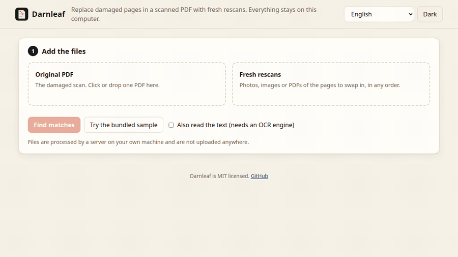

<p align="center"></p>

<h1 align="center">Darnleaf</h1>

<p align="center"><b>Sustituye las páginas dañadas de un PDF escaneado por reescaneos nuevos. Emparejar, revisar, exportar. Nada sale de tu equipo.</b></p>

<p align="center"></p>

[English](README.md) · [繁體中文](README.zh-TW.md) · [简体中文](README.zh-CN.md) · [日本語](README.ja.md) · [한국어](README.ko.md) · [Español](README.es.md) · [Français](README.fr.md) · [Deutsch](README.de.md) · [Português (Brasil)](README.pt-BR.md)

Tienes un PDF escaneado antiguo con algunas páginas estropeadas y escaneos nuevos de esas páginas, sin ningún orden. Darnleaf propone qué página sustituye cada reescaneo, te enseña las pruebas y escribe un PDF reparado junto con un recibo JSON de cada cambio.

- **No es un reparador automático.** Cada coincidencia se marca como Segura, Revisar o Sin coincidencia. La exportación queda bloqueada hasta que confirmes cada Revisar, y las páginas en blanco son siempre Revisar, igual que cualquier página cuyo segundo candidato puntúe cerca.
- **No reescribe el archivo.** Las páginas que no tocaste son los objetos de página originales, guardados sin volver a renderizar. El archivo original nunca se modifica.
- **No es un servicio.** Es un pequeño servidor en 127.0.0.1, sin cuenta, sin subidas y sin telemetría. La página no carga fuentes ni scripts remotos.

## Pruébalo

```sh
pipx install git+https://github.com/Arthur031221/Darnleaf
darnleaf serve
```

Pulsa **Probar la muestra incluida** para ver todo el proceso con un cuadernillo sintético de 40 páginas, o suelta tus propios archivos. La [demo de repetición](https://arthur031221.github.io/Darnleaf/) reproduce en el navegador una ejecución real de esa muestra. No acepta archivos. Con `darnleaf serve original.pdf rescans/*.jpg` los archivos se cargan y la búsqueda de coincidencias empieza sola.

```console
$ darnleaf sample job
wrote job/original.pdf, 7 rescans and truth.json
$ darnleaf match job/original.pdf job/rescans/*.jpg
rescan                        page  status  reason
rescan-01.jpg                   33  check   page 35 scores almost as high (margin 0.02)
rescan-02.jpg                   11  clear   205 consistent features, margin 0.60
rescan-03.jpg                    2  check   blank pages carry no evidence: confirm the position yourself
rescan-04.jpg                   22  clear   428 consistent features, margin 0.94
rescan-05.jpg                   31  check   page 32 scores almost as high (margin 0.05)
rescan-06.jpg                   27  clear   230 consistent features, margin 0.78
rescan-07.jpg                    -  none    no original page shares enough features or text with this rescan
$ darnleaf apply job/original.pdf job/rescans/*.jpg -o job/repaired.pdf
replaced 3 of 40 pages -> job/repaired.pdf
receipt -> job/repaired.receipt.json
```

`apply` usó solo las tres coincidencias Seguras. Las de Revisar esperan en la pantalla de revisión o en `--assign FILE=PAGE`.

## Pruebas de rendimiento

Medido con cuadernillos sintéticos hechos con texto de dominio público (*Orgullo y prejuicio*): 90 reescaneos en diez semillas reservadas (101 a 110). Las páginas se dañan con un cerco de café, un pliegue y una mancha. Los reescaneos llevan inclinación, ruido, desenfoque y giros de un cuarto de vuelta al azar. Los umbrales se ajustaron solo con las semillas 1 a 3. Se reproduce con `python scripts/benchmark.py --seeds 101-110`.

| Tipo de página | Reescaneos | Segura | Revisar | Sin coincidencia | Segura errónea | Respuesta correcta listada |
| --- | ---: | ---: | ---: | ---: | ---: | ---: |
| Texto | 43 | 42 | 1 | 0 | 0 | 43 |
| Figura | 3 | 3 | 0 | 0 | 0 | 3 |
| Formulario repetido | 24 | 0 | 24 | 0 | 0 | 24 |
| Página en blanco | 10 | 0 | 9 | 1 | 0 | 9 |
| No está en el cuadernillo | 10 | 0 | 0 | 10 | 0 | 10 |
| **Todas** | **90** | **45** | **34** | **11** | **0** | **89 / 90** |

De 45 coincidencias Seguras, ninguna fue errónea. Con solo 45 pruebas, la tasa real de error aún podría llegar a cerca del 6,7 % (regla de tres, 95 % de confianza). La primera sugerencia fue correcta (o correctamente Sin coincidencia) en el 95,6 % de los reescaneos.

Léelo como un límite superior. El original y el reescaneo salen del mismo mapa de bits limpio, así que coinciden mejor que un reescaneo real en un escáner de cama plana de una página gastada. Con documentos reales es probable que haya más Revisar y Sin coincidencia. Además, las 45 coincidencias Seguras son todas páginas de texto y figuras con contenido distinto, y los formularios y las páginas en blanco son las mismas páginas fijas en todas las semillas.

Las fotos de móvil rara vez quedan paralelas a la página. Con `--tilt 0.04`, cada reescaneo de las mismas diez semillas se deforma como si se hubiera fotografiado en ángulo, con cada esquina desplazada hasta un 4% de la página. La versión 0.4.0 da 46 Seguras y ninguna errónea, y la primera sugerencia es correcta (o correctamente Sin coincidencia) en 77 de 90. La 0.3.0 daba 31 Seguras y 46 de 90, porque solo modelaba un escaneo plano. Las páginas en blanco pasan a Sin coincidencia con inclinación, porque el borde de la mesa parece tinta: colócalas a mano. La ejecución está en `docs/benchmark-tilted.json`.

## Instalación

```sh
pipx install git+https://github.com/Arthur031221/Darnleaf
darnleaf --version
```

Python 3.10 o superior. Todavía no está en PyPI. La suite completa se ejecuta en Linux. Las pruebas de CLI, exportación e imágenes también se ejecutan en CI en macOS y Windows, pero el motor de coincidencias solo se ha probado en Linux.

## Límites

- Rechaza PDF cifrados, PDF con firma digital, PDF con campos de formulario y páginas con un `Rotate` que no sea múltiplo de 90.
- Hasta 200 páginas en el original, 40 reescaneos, 400 MB para el original y 60 MB por reescaneo.
- Las páginas con anotaciones no se sustituyen a menos que indiques que se pueden descartar.
- Dos páginas casi idénticas no se distinguen solo con imágenes, así que pasan a Revisar cuando el segundo candidato puntúa cerca. Una página en blanco no aporta pruebas y siempre es Revisar.
- La interfaz está traducida a nueve idiomas, incluido el motivo bajo cada coincidencia. La salida de `darnleaf match` está en inglés. Las fotos HEIC del iPhone necesitan `pip install "darnleaf[heic]"`.

Más información en la documentación en inglés: [docs/usage.md](docs/usage.md) y [docs/how-it-works.md](docs/how-it-works.md). Para colaborar, consulta [CONTRIBUTING.md](CONTRIBUTING.md). Licencia MIT, véase [LICENSE](LICENSE).

Assisted by Claude/Codex.
